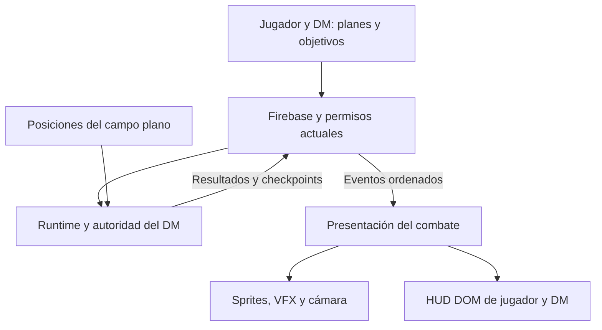

# Plan de integración de combate, animaciones y HUD para Luminos

Fecha de revisión del alcance: 18 de octubre de 2026.

**Decisión confirmada:** Forest corresponde a otra idea. Esta integración utiliza un campo plano con profundidad visual por capas, posicionamiento y presentación teatral inspirada en Limbus. No depende de #933.

**Decisión propuesta:** conservar Luminos como sistema de juego y plataforma online, y adaptar de Limbus Archive su forma de presentar Clash, Coins, ataques, efectos y personajes. La integración se hará por capas y entregas jugables, con el mismo resultado de combate para DM y jugadores.

La revisión base corresponde al 17 de octubre. Las fases 0, 1, 2 y 3 cuentan con implementaciones encadenadas en los PR #986, #987, #988 y #989, sin fusionar ni desplegar. La Fase 4 se integra en #990 y se valida sobre esa misma cadena. El resto de este documento describe el alcance y los criterios de las entregas siguientes; no certifica su aceptación final.

**1. Base revisada y alcance real**

| Fuente | Referencia revisada | Qué implica |
| --- | --- | --- |
| Luminos, `main` | `a879160ec397e1b557b53626d0d10b1f191a1da3` | Base de implementación, reglas, catálogos, identidad y persistencia. |
| Schirke/limbus-archive, `main` | `e346e93c155739dead66645728c50cadcbe9d7b4` | Referencia de presentación y herramientas de sprites; analizar cada pieza antes de reutilizarla. |
| PR #933 | Draft; `6d445f4b6c0ba6a023c4001f2830dde8b9ed3997` | Contrato de migración espacial. Contiene un documento de trabajo; sus listas pendientes no certifican implementación. |
| PR #984 | Draft; `d6ee776fa0a9e8495dfabdb83e965248b6adc899` | Cambios propuestos para Skills del DM en combate activo, HUD de Coins y cámara. Exige aceptación real DM/Player y móvil antes de fusionar. |
| PR #843 | Abierto; `4d6f3d78d5f991f4d335cd012c38207a7d41d2a7` | Adaptación de hechizos de nivel 1. Fog Cloud y Grease aparecen en su trabajo; comprobar sus dependencias al preparar los pilotos espaciales. |

Archive tiene capacidades útiles de animación, efectos y Versus. Su aplicación completa depende de Windows, archivos de una instalación del juego y un renderizador Unity que el README identifica como externo al repositorio. Además, el código público referencia módulos como `viewer`, `versus_engine`, `versus_team` y `battle_ui` cuyas fuentes no aparecen en el árbol revisado. La integración debe presupuestar adaptadores y desarrollo propio para esas capacidades.

La sala online de Archive utiliza WebSocket y reproduce una pelea con una semilla compartida. Luminos ya tiene autenticación, propiedad de personajes, planes, autoridad y persistencia mediante Firebase. Conservaremos esa infraestructura.

**2. Qué incorporar de Archive**

| Capacidad | Adaptación para Luminos | Entrega |
| --- | --- | --- |
| Clash visible y automático | Mostrar preparación, contacto, potencia, empates, Coins perdidas y ataque del vencedor utilizando los resultados de nuestras reglas. | V1 |
| Ataques por Coin | Cada Coin tiene su preparación, resultado, impacto y efectos correspondientes. Respetar cancelaciones y muerte entre Coins. | V1 |
| Poses de combate | Idle, movimiento, ataque, golpe recibido, Guard, Evade, Counter, Stagger, muerte y lanzamiento. Perfil genérico cuando falte una pose. | V1 |
| Lectura de HP y daño | Barras, umbrales, números y avisos sincronizados con la acción que se está mostrando. Incorporar SP y Status propios de Luminos. | V1 |
| Status y VFX | Manifestar aplicación, consumo y expiración con iconos, Potency/Count y efectos visuales asociados. | V1 |
| Personajes por capas y frames | Atlas y secuencias con pivote de pies estable, facing y escala coherentes. Compatible con sprites actuales y razas propias. | V1 |
| Escenario, encuadre y sonido | Escenario plano por capas, seguimiento de participantes, prioridades de audio y efectos con límites de rendimiento. | V1 básica; acabado posterior |
| Cut-ins de habilidades | Secuencias breves para acciones seleccionadas; saltables y sin modificar la resolución. | V2 |
| Taller de sprites | Herramienta de autoría para importar, alinear y previsualizar poses y acciones de nuestros personajes. | V2 |
| Roles de combatientes | Evaluar como entradas del planificador/IA existente, después de estabilizar la escena. | V2 |

Las fórmulas de daño, recursos, economía de acciones, catálogo y progresión siguen procediendo de Luminos. El autobattler de Archive contiene reglas propias de roles, cooldowns y balance de jefes; incorporarlas requeriría una decisión de diseño separada.

**3. Contrato que conserva el online**

El flujo actual encontrado en `combat-v073-authority.js`, `combat-v073-plan-sync.js` y `combat-v073-remote-intents.js` es:

1. Cada jugador prepara planes y objetivos de su combatiente y declara Ready.
2. Firebase valida identidad, propiedad, fase y las condiciones del plan.
3. El DM comprueba los planes y sella la ronda con una semilla común.
4. Los clientes reproducen la resolución con esos datos. El DM publica checkpoints con secuencia, estado, cursor de azar y digest.
5. Los clientes comparan y se corrigen con el estado del DM; el cierre de ronda persiste el resultado y devuelve el encuentro a planificación.

La migración conservará este contrato durante las primeras entregas. La arquitectura actual combina reproducción determinista en clientes y checkpoints del DM; cualquier paso hacia clientes que solo reproduzcan resultados requiere una entrega explícita y pruebas de equivalencia.

| Elemento actual | Compromiso de integración |
| --- | --- |
| Firebase Auth y rol DM/Player | Reutilizar la sesión actual. |
| `campaña/jugadores` y Units enlazadas | Preservar identidad canónica y relación con el propietario. |
| `campaña/combate/combatants` | Mantener combatientes y estado de juego; añadir datos espaciales mediante contrato versionado. |
| `plannedActions` y `readyPlayers` | Conservar planificación por Action Slot, cancelación de Ready y validación de propiedad. |
| `authority/current` | Mantener sellado, semilla, fase y checkpoints; ampliar metadatos de forma compatible. |
| Inventario, recursos y vitales | Mantener los servicios y puentes canónicos de persistencia. |
| Permisos de base de datos | Extender y probar las rutas nuevas con las mismas restricciones de autoridad. |

Una animación, un sonido o una cámara podrán representar un resultado. La mutación de HP, SP, Status, inventario, posición o recursos seguirá perteneciendo al runtime autorizado.

**4. Separación de reglas, espacio y presentación**

El diagrama describe la arquitectura objetivo. La primera etapa mantiene la reproducción determinista existente mientras se verifica la nueva salida de eventos.

| Capa | Responsabilidad |
| --- | --- |
| Runtime de Luminos | Speed, Action Slots, Clash, Coins, Saves, daño, defensas, Status, HP/SP, recursos, reacciones y ciclo de ronda. |
| Campo plano | Posiciones canónicas y selección. La presentación separa el desplazamiento visual de los ataques de las posiciones guardadas. |
| Presentación | Cola de animaciones, poses, desplazamientos visuales, impactos, cámara y sonido. |
| HUD | Lectura y decisiones del jugador/DM en pantalla, con nombres y conceptos del juego. |
| Firebase | Transporte, permisos y persistencia de planes y resultados autorizados. |

Hay dos separaciones especialmente necesarias:

- El runtime live incluye efectos como Bleed y consumo de Paralysis dentro del flujo de animación de Coins. Se extraerá una resolución por pasos que aplique esos efectos en su orden actual y produzca datos para animar. Resolver una Coin puede cambiar las condiciones de la siguiente; la extracción debe conservar esa secuencia.
- Las aproximaciones y retrocesos visuales de un Clash se separarán de la posición espacial real. Un desplazamiento que consume movimiento, atraviesa terreno o activa un área debe validarse mediante el puente espacial. Las poses y la cámara utilizan transformaciones de presentación.

**5. Eventos y reproducción compartida**

Se propone una salida de eventos versionada. Nombres orientativos:

`RoundSealed`, `ActionStarted`, `ClashStarted`, `CoinRolled`, `ClashRoundResolved`, `CoinBroken`, `DamageApplied`, `HealingApplied`, `StatusChanged`, `UnitStaggered`, `UnitDefeated`, `ActionCancelled`, `ActionFinished` y `RoundFinished`.

Cada evento tendrá identidad de encuentro/ronda, secuencia, acción/slot, participantes y resultado. Los eventos por Coin incluirán su índice y la información necesaria para mostrar sus efectos. El resultado visual consumirá esos datos y los catálogos; sus marcadores de impacto no volverán a aplicar daño.

La implementación deberá:

1. Extraer primero resolución y presentación conservando las entradas, orden y resultados del runtime actual.
2. Comparar la traza resultante contra el comportamiento de referencia, incluyendo efectos que cambian o cancelan Coins posteriores.
3. Publicar desde el DM lotes ordenados por acción junto con una referencia al checkpoint correspondiente. No enviar frames ni partículas por Firebase.
4. Mantener la simulación determinista existente como compatibilidad durante la transición. Evitar que el HUD nuevo lea estado local adelantado respecto de la acción mostrada.
5. Habilitar la reproducción desde eventos después de probar equivalencia; retirar gradualmente los efectos visuales del resolver anterior.

**Ruta propuesta:** una rama hermana de `authority/current`, como `campaña/combate/playback/{encounterId}/{round}/{batchSeq}`. La fase inicial debe confirmar el identificador de encuentro disponible y el esquema exacto. Separar los lotes evita agrandar cada actualización del listener que lee `authority/current` completo.

El contrato incluirá:

- Identificador de encuentro y generación de autoridad para distinguir reinicios y reintentos.
- `schemaVersion` y revisión de reglas/catálogo compatible entre clientes.
- Orden y deduplicación: reprocesar un lote no duplica efectos persistentes ni reproduce dos veces el mismo impacto.
- Escritura coherente entre lote, cursor y checkpoint; ningún cliente publica un resultado canónico.
- Reanudación desde un checkpoint y su cursor de presentación, con historial acotado y limpieza al terminar el encuentro.
- Azar visual independiente del azar de reglas. Partículas, variaciones de sonido y cámara no consumen el generador de combate.
- Coordinación temporal mediante tiempo de servidor y posición en la secuencia. Un cliente lento puede alcanzar el punto actual sin repetir acciones.
- Pausa y recuperación si se pierde la autoridad del DM. La política inicial conserva al DM como autoridad; una transferencia automática sería otro proyecto.
- Control de sellado para impedir dos resoluciones del mismo turno desde dos pestañas del DM.

Los controles de velocidad y movimiento reducido cambian la reproducción. Su aceptación exige iguales resultados de juego con animación completa, reducida y omitida.

**6. Mecánicas que debe cubrir la primera versión**

| Mecánica de Luminos | Comportamiento a preservar y mostrar |
| --- | --- |
| Speed y Action Slots | Mostrar orden de ronda, acciones disponibles y objetivo de cada slot, conservando desempates y límites actuales. |
| Clash | Selección/intercepción válida, empates, pérdida de Coins y ejecución del vencedor. |
| Ataque Unopposed | Resolver y presentar los impactos correspondientes sin inventar un Clash. |
| Guard / Evade / Counter | Reutilizar su lógica y economía, con feedback reconocible para cada defensa. |
| Coins normales y Unbreakable | Representar sus estados según el Coin Engine vigente y comprobar su soporte en el runtime live. |
| Efectos por Coin | Respetar Bleed, Paralysis, críticos y los efectos declarados para cada Coin. |
| Stagger y muerte | Cancelar acciones/Coins pendientes cuando corresponde y actualizar las presentaciones en cola. |
| Skills y Spells | Obtener kit, selección, costes y resultado de los adaptadores y catálogos existentes. |
| Saves y curación | Mostrar resultado, daño parcial cuando corresponda, curación y recursos consumidos. |
| Estado persistente | Conservar consumibles, munición, cargas, vitales y demás cambios que el runtime ya persiste. |

Los documentos adjuntos de Lanae, Yuan-ti y otras razas se utilizarán como casos de compatibilidad para rasgos, resistencias, inmunidades y acciones especiales. Las adaptaciones numéricas se contrastarán con la implementación canónica de Luminos. La animación debe admitir distintos cuerpos y perfiles visuales sin imponer un kit estándar de Sinner.

**7. HUD de producto**

| Superficie | Qué ve y hace el usuario |
| --- | --- |
| Estado del jugador | Retrato, HP, SP, umbrales de Stagger, Speed y Status relevantes. |
| Menú de acciones | Skills, Spells, defensas, objetos y acciones legítimas disponibles según el personaje y la fase. |
| Tarjeta de Skill | Nombre, icono, potencia, Coins, tipo de daño/Sin, alcance, coste y efectos por Coin. |
| Planificación | Slots propios, selección de objetivos, previsión disponible según nuestras reglas, Ready y cancelación antes del sellado. |
| Resolución | Participantes, Coin actual, potencia, resultado del Clash y efectos que están ocurriendo. |
| Consulta del objetivo | Información del objetivo que el juego permita conocer; respetar información oculta del DM. |
| Panel DM | Roster, despliegue, preparación de jugadores, inicio de ronda y administración real del encuentro. |
| Conexión | Mensajes breves como “Reconectando”, “Esperando al DM” o “Preparando recursos” cuando requieren atención. |

Se conservará el menú radial Limbus y se adaptará el HUD existente. El PR #984 constituye la primera base que debe reconciliarse con `main`.

En escritorio, las tarjetas y detalles podrán aprovechar paneles laterales. En móvil, el deck será desplazable y el detalle se abrirá con toque, con objetivos táctiles de al menos 44 px. El diseño debe funcionar en vertical y horizontal, con safe areas y paneles que protejan el campo de batalla.

El HUD será DOM en espacio de pantalla. Permanecerá derecho durante los movimientos de cámara y los ataques. La UI principal utilizará nombres, iconos y lenguaje del juego. IDs, JSON, digests, cursores, herramientas de prueba y paneles técnicos quedarán en superficies de desarrollo opt-in, conforme al adjunto de UI.

**8. Animación y recursos**

Se propone un manifiesto visual separado del catálogo de reglas, enlazado por claves estables. Se reutilizará el registro de recursos visuales de hechizos donde corresponda y se añadirá un perfil de animación para Unit/Skill.

Cada perfil podrá declarar:

- Sprite o atlas, frames, duración, pivote de pies y escala.
- Poses disponibles y una sustitución genérica para las ausentes.
- Clips por acción/Coin, orientación y puntos de salida de proyectiles.
- Marcadores de preparación, impacto y recuperación para la reproducción.
- VFX, audio y prioridad de cámara; calidad reducida y movimiento reducido.

La primera versión usará sprites 2D anclados por los pies al campo plano. Un personaje con una imagen estática seguirá siendo jugable mediante poses y transiciones genéricas. Recursos ausentes o fallos de audio tendrán una presentación de sustitución que permita completar la ronda.

Los atlas, sonidos y efectos se cargarán por encuentro y se liberarán al cerrarlo. Firebase transportará claves y resultados; los recursos tendrán una distribución y caché propias del cliente.

Archive puede servir también como herramienta externa de referencia y preparación. El juego entregado deberá funcionar en navegador y móvil con recursos disponibles para Luminos. El código público tiene licencia MIT: cualquier adaptación sustancial conservará su aviso. El README distingue esa licencia de los recursos pertenecientes a Project Moon; la procedencia y condiciones de cada recurso se revisarán antes de incorporarlo.

**9. Profundidad y posicionamiento sin Forest**

- Horizonte, arquitectura, suelo y primer plano con recursos locales y paralaje.
- Coordenadas planas existentes como autoridad de posición; las capas y la cámara no cambian reglas ni consumen RNG.
- Pies estables, sombras de contacto, escala visual por profundidad y superposición según su posición en el suelo.
- Formación inicial del DM desde el flujo del encuentro: elegir combatiente, tocar el suelo y terminar colocación. Solo antes de planes, READY y primer sellado.
- Los Players reciben las posiciones guardadas por Firebase, conservan identidad y controlan sus propias acciones.
- Un único canvas existente y el mismo fondo por capas para WebGL y fallback DOM.
- El primer piloto es una calle industrial original. La selección de otros escenarios y el acabado artístico se amplían después.

Alturas, escalada, navegación, terreno difícil, cobertura y el mapa de #933 quedan fuera de esta integración. El movimiento táctico de turno requerirá decisiones de reglas separadas; los avances y retrocesos cinematográficos siguen siendo presentación.

**10. Entregas y dependencias**

| Entrega | Trabajo concreto | Depende de | Criterio para cerrarla |
| --- | --- | --- | --- |
| 0. Base y contratos | Reconciliar #984 con `main`; actualizar #933; fijar versiones, identidad y pruebas de referencia. Identificar fuente editable y generación del bundle live. | Revisión actual | El combate previo funciona en dos sesiones y el kit del DM llega al combatiente correcto. |
| 1. Resolución por pasos | Extraer cálculo/efectos de Coins del flujo visual; generar eventos conservando las APIs de compatibilidad. | 0 | Mismo estado, orden y azar de reglas con animaciones activas y desactivadas. |
| 2. Reproducción online | Lotes del DM, secuencia, checkpoints, deduplicación, reconexión y permisos. Migración gradual de clientes. | 1 | DM y jugadores coinciden; recarga, retraso y reintentos no duplican costes ni resultados. |
| 3. Escena por capas y posicionamiento | Campo plano, paralaje, sombras, escala y superposición por profundidad; formación inicial del DM sincronizada. | 2 | Posiciones compartidas y persistidas; escenario legible en escritorio y móvil; fallback DOM. |
| 4. HUD y animación V1 | Integrar menú radial, tarjetas, estado por Coin, poses genéricas y feedback de defensas/Status. | 3; base de HUD de 0 | Una ronda completa se entiende y controla mediante los flujos reales del juego. |
| 5. Acabado audiovisual | Perfiles por Skill, proyectiles, impactos, cámara, mezcla de sonido y cut-ins seleccionados. | 4 | Todo tiene sustitución; calidad visual y velocidad de reproducción no alteran la partida. |
| 6. Aceptación y activación | Matriz online, escritorio/móvil, entrada/salida repetida, regresiones y activación gradual por encuentro. | 5 | Evidencia real multijugador y visual, con retorno al visor anterior desde un límite seguro. |

Cada entrega debe terminar en un flujo utilizable. Las herramientas internas para provocar estados no sustituyen el comportamiento del juego.

No conviene fijar fechas de producción antes de medir las entregas 0 y 1: la extracción del runtime empaquetado y el desacoplamiento de efectos por Coin determinan buena parte del esfuerzo.

**11. Mapa técnico para los futuros PR**

Las rutas nuevas de esta tabla son propuestas de organización, no archivos ya existentes.

| Área | Código actual a reutilizar/revisar | Adición propuesta |
| --- | --- | --- |
| Arranque live | `Battle-viewer.html`, `combat/*.bundle.part*` y partes de reparación | Fuente editable y generación reproducible; reducir nuevas sustituciones de texto en el bootstrap. |
| Autoridad | `js/combat-v073-authority.js` | Salida de resultados, coordinación y referencias al cursor de reproducción. |
| Planes y propiedad | `js/combat-v073-plan-sync.js`, `js/combat-v073-remote-intents.js`, `js/battle-viewer-ownership-074.js` | Extensiones versionadas para objetivos espaciales y protección frente a datos de otra ronda. |
| Sesión online | `js/battle-viewer-firebase-session-074.js`, `database.rules.json` | Suscripción y permisos para reproducción; probar rutas nuevas en emulador. |
| Reglas y Coins | Runtime live, `js/combatEngine.js`, `js/coin-engine-core.js` | Contrato `CombatResultEvents`; extracción por pasos con equivalencia. |
| Escena | Fuente live y renderer existente | `combat-v073-stage.js`, CSS y recursos originales por capas; formación inicial sincronizada. |
| Presentación | Puentes y callbacks visuales actuales | `CombatPresentationDirector`, `CombatPlaybackSync` y `CombatAnimationRegistry`. |
| HUD | `js/player-skills-hud.js`, planners 0.7.4 y cambios de #984 | View models de combate y componentes compartidos, conservando diferencias de rol. |
| Recursos | `js/spell-visual-asset-registry.js`, `BrowserAssetCache` | Manifiestos de animación y VFX enlazados al contenido existente. |
| Ciclo de vida | `js/combat-encounter-lifecycle.js`, `js/combat-v073-live-adapter.js` | Montaje/desmontaje de playback, escena, listeners y recursos por encuentro. |

El bundle live contiene lógica que no se cubre editando únicamente `combatEngine.js`. La entrega 0 debe identificar qué funciones son efectivamente ejecutadas y establecer cómo se regeneran los artefactos, evitando divergir entre dos implementaciones de las mismas reglas.

**12. Matriz mínima de aceptación**

| Caso | Evidencia requerida |
| --- | --- |
| DM + dos jugadores | Mismos planes sellados, resultados por Coin, HP/SP, Status y estado final. |
| Propiedad | Un jugador no puede planificar por otra Unit ni publicar lotes/checkpoints canónicos. |
| DM cambia un kit | Actualización del personaje/Unit y combatiente correcto, según el flujo aprobado de #984. |
| Coins y efectos | Bleed, Paralysis, Coins normales/Unbreakable y efectos declarados se ejecutan una vez y en el orden esperado. |
| Defensas y cancelaciones | Guard, Evade, Counter, Stagger y muerte producen el mismo resultado con cualquier modo visual. |
| Reconexión | Recargar durante Clash, mitad de una Skill o cierre de ronda recupera el punto válido sin volver a cobrar recursos. |
| Red adversa | Ensayos con 250–500 ms de retraso añadido, reintentos, duplicados y llegada tardía de lotes. |
| DM desconectado / dos pestañas DM | La ronda no obtiene dos resoluciones; la interfaz comunica espera y permite recuperación controlada. |
| Versiones distintas | Detección antes de Ready; comportamiento compatible o actualización requerida expresada al usuario. |
| Posición | Formación inicial coincide entre sesiones y tras recargar; cámara y ataques no mutan posiciones canónicas. |
| Móvil | Vertical y horizontal: lectura, selección táctil, detalle de Skills y menú radial utilizables. |
| Recursos ausentes | Sprite, VFX o audio faltantes no bloquean una ronda ni alteran sus resultados. |
| Rendimiento | Medir baseline; objetivos iniciales de 60 FPS en escritorio y 30 FPS en móvil de referencia, ajustando efectos. |
| Ciclo de vida | Diez entradas/salidas de encuentro sin crecimiento acumulativo de renderers, suscripciones o recursos retenidos. |
| Persistencia | Refrescar después del combate conserva vitales, inventario y costes canónicos. |

Se reutilizarán las suites existentes de autoridad, sincronización, ownership, planes, Coins, ciclo de vida y Game Engine, ampliándolas con los casos que cambian. Los mocks y pruebas estáticas se complementarán con sesiones autenticadas reales y revisión visual; actualmente este plan no certifica esa aceptación.

La activación será gradual y versionada por encuentro. Las comparaciones entre visor nuevo y anterior se harán en pruebas separadas. Un cambio de visor o retorno al anterior ocurrirá desde un checkpoint o límite de ronda compatible; el estado de juego persistido mantendrá su identidad.

**13. Primera entrega jugable que buscamos**

El DM prepara un encuentro en un escenario plano por capas con dos aliados y cuatro enemigos, y coloca su formación inicial antes de planificar. Cada jugador ve su personaje, HP/SP, Skills, Coins, Status y slots, prepara objetivos y declara Ready. El DM sella la ronda; todos ven el mismo Clash, pérdida de Coins, impactos, defensas y cambios de estado.

Un jugador puede usar una presentación reducida o reconectarse sin cambiar el resultado. La ronda termina con el mismo estado persistido para todas las sesiones. El HUD permanece legible en móvil y no contiene controles de prueba ni datos internos.

Ese hito demuestra combate, animación, HUD y online juntos. Después permite ampliar variedad visual por Skill y personaje sobre la misma arquitectura.

**Referencias primarias**

- [Limbus Archive: README y alcance](https://github.com/Schirke/limbus-archive/blob/e346e93c155739dead66645728c50cadcbe9d7b4/README.md).
- [Archive: sala Versus online](https://github.com/Schirke/limbus-archive/blob/e346e93c155739dead66645728c50cadcbe9d7b4/ui/versusroom.js).
- [Archive: visor de pelea](https://github.com/Schirke/limbus-archive/blob/e346e93c155739dead66645728c50cadcbe9d7b4/ui/versus_view.html).
- [Archive: curvas y capas de animación](https://github.com/Schirke/limbus-archive/blob/e346e93c155739dead66645728c50cadcbe9d7b4/limbusdm/clips.py) y [frames y pivotes](https://github.com/Schirke/limbus-archive/blob/e346e93c155739dead66645728c50cadcbe9d7b4/limbusdm/frames.py).
- [Luminos: autoridad y checkpoints](https://github.com/sokcrow/Luminos-Character-Maker/blob/a879160ec397e1b557b53626d0d10b1f191a1da3/js/combat-v073-authority.js).
- [Luminos: sincronización de planes](https://github.com/sokcrow/Luminos-Character-Maker/blob/a879160ec397e1b557b53626d0d10b1f191a1da3/js/combat-v073-plan-sync.js) y [reglas Firebase](https://github.com/sokcrow/Luminos-Character-Maker/blob/a879160ec397e1b557b53626d0d10b1f191a1da3/database.rules.json).
- [Luminos: arranque y bundle live](https://github.com/sokcrow/Luminos-Character-Maker/blob/a879160ec397e1b557b53626d0d10b1f191a1da3/Battle-viewer.html).
- [Luminos: runtime de combate](https://github.com/sokcrow/Luminos-Character-Maker/blob/a879160ec397e1b557b53626d0d10b1f191a1da3/js/combatEngine.js) y [Coin Engine](https://github.com/sokcrow/Luminos-Character-Maker/blob/a879160ec397e1b557b53626d0d10b1f191a1da3/js/coin-engine-core.js).
- [Luminos: Game Engine y movimiento continuo](https://github.com/sokcrow/Luminos-Character-Maker/blob/a879160ec397e1b557b53626d0d10b1f191a1da3/game-engine/README.md).
- [PR #933: integración espacial](https://github.com/sokcrow/Luminos-Character-Maker/pull/933).
- [PR #984: HUD, cámara y Skills del DM](https://github.com/sokcrow/Luminos-Character-Maker/pull/984).
- [PR #843: hechizos de nivel 1](https://github.com/sokcrow/Luminos-Character-Maker/pull/843).

Reglas de producto consideradas: adjuntos de UI sin debug y documentos homebrew de esta conversación.
